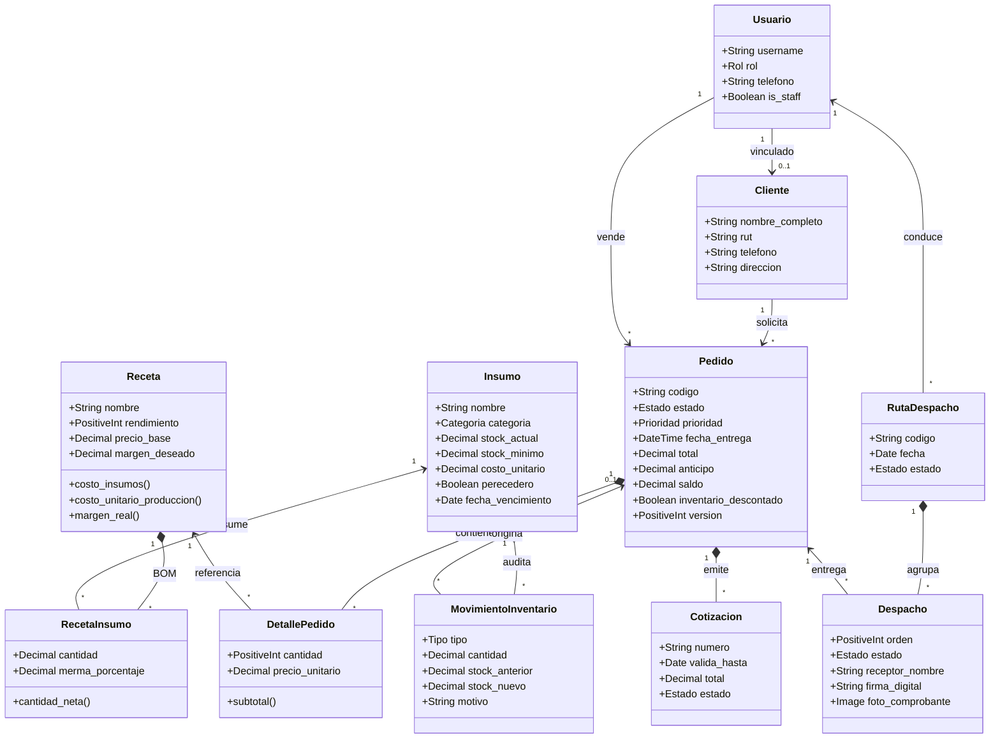
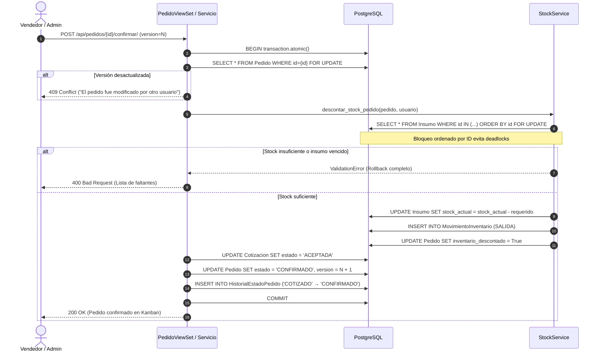
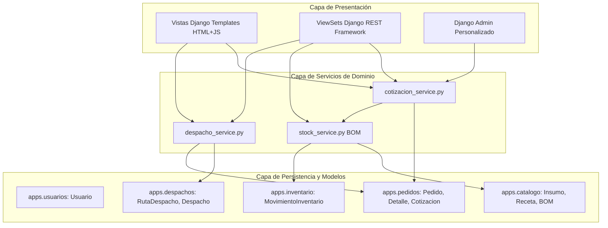
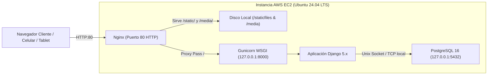

# Arquitectura del Sistema Dulce Arte (Vistas 4+1)

El sistema **Dulce Arte** implementa una arquitectura en capas desacoplada para garantizar trazabilidad end-to-end, concurrencia segura y alta mantenibilidad. Se documenta bajo el modelo **4+1 Vistas de Kruchten**.

---

## 1. Vista Lógica (Entidades y Relaciones del Dominio)

La vista lógica modela las entidades fundamentales del negocio y sus relaciones:

---

## 2. Vista de Procesos (Concurrencia y Transacciones)

### Confirmación Atómica de Pedido y Descuento de Stock (BOM)

---

## 3. Vista de Desarrollo (Estructura de Apps y Capas)

---

## 4. Vista Física (Despliegue en AWS EC2 Monolito)

---

## 5. Escenarios (Casos de Uso Principales)

1. **Cotización y Venta:** El vendedor crea un pedido en `BORRADOR` con ingredientes y personalización. Emite la cotización formal pasando el estado a `COTIZADO`.
2. **Confirmación y Descuento de Bodega:** El cliente aprueba y abona. Se confirma el pedido descontando automáticamente las materias primas según el BOM en una transacción atómica.
3. **Producción Kanban en Cocina:** El equipo de cocina visualiza el pedido en la columna *Recibido* y lo avanza por *En Preparación*, *Horneado/Decorado*, *Control de Calidad* hasta *Listo*.
4. **Logística y Despacho:** Se agrupan pedidos listos en una `RutaDespacho`. El repartidor inicia la ruta, accede a las direcciones en Google Maps y confirma la entrega registrando la firma digital o fotografía del cliente.
